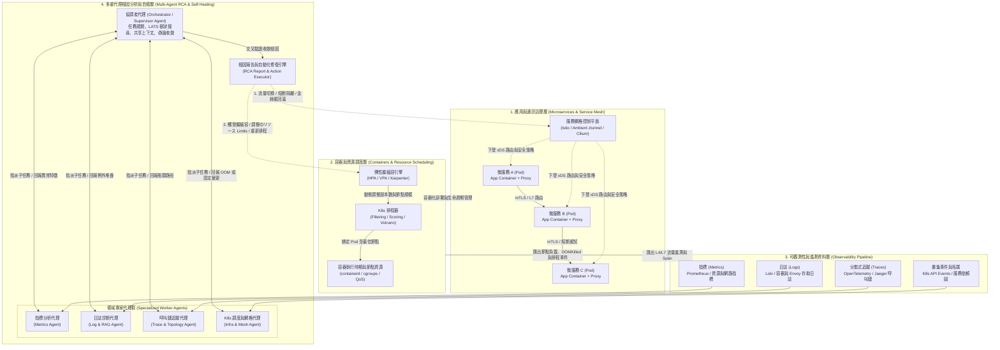

# 雲原生微服務與智慧維運（AIOps）整合架構總覽

本知識庫系統性地整理了現代雲原生系統至智慧化維運的六大核心技術領域：**微服務（Microservices）**、**容器（Containers）**、**服務網格（Service Mesh）**、**資源調度（Resource Scheduling）**、**多重代理系統（Multi-Agent Systems, MAS）** 以及 **根因分析（Root Cause Analysis, RCA）**。

---

## 一、 檔案導覽目錄

1. **[00_總覽與整合架構藍圖.md](./00_總覽與整合架構藍圖.md)**（本文件）
   - 六大領域之演進脈絡與整合關係、端到端全景架構圖、技術演進對照表。
2. **[01_微服務與容器化技術.md](./01_微服務與容器化技術.md)**
   - 微服務設計原則、拆分策略、通訊模式（REST/gRPC/Event-Driven）、分散式交易（Saga）、容器底層原理（Namespaces/cgroups/UnionFS）與 OCI 標準。
3. **[02_服務網格_Service_Mesh.md](./02_服務網格_Service_Mesh.md)**
   - 服務網格核心概念、控制平面與資料平面（Istio + Envoy）、Sidecar 模式 vs. 無 Sidecar 架構（Istio Ambient Mesh `ztunnel` & Cilium eBPF）、流量治理、mTLS 零信任安全與可觀測性。
4. **[03_資源調度_Resource_Scheduling.md](./03_資源調度_Resource_Scheduling.md)**
   - Kubernetes `kube-scheduler` 兩階段排程演算法（Filtering & Scoring）、QoS 等級（Guaranteed / Burstable / BestEffort）、多維度自動擴縮容（HPA / VPA / KEDA / Karpenter）與 AI/批次排程器（Volcano）。
5. **[04_多重代理系統_Multi_Agent_System.md](./04_多重代理系統_Multi_Agent_System.md)**
   - LLM Agent 核心結構（Planning、Memory、Tool Use / MCP）、多重代理協作拓撲（Supervisor、Hierarchical、Debate）、進階推理框架（ReAct、LATS 樹狀搜尋）與雲原生落地考量。
6. **[05_根因分析_Root_Cause_Analysis_與_AIOps整合.md](./05_根因分析_Root_Cause_Analysis_與_AIOps整合.md)**
   - 微服務故障傳播與警報海嘯問題、可觀測性三支柱（Metrics / Logs / Traces）、傳統 RCA（因果圖、隨機漫步）vs. 多重代理 RCA（LATS-RCA、K-MAS），以及與服務網格、資源調度連動的「自動自癒閉環（Self-Healing Closed Loop）」。

---

## 二、 六大技術領域的因果與演進脈絡

為什麼這六個主題會緊密結合在一起？它們代表了現代分散式系統從**「構建」→「封裝與運行」→「連線與治理」→「動態資源最佳化」→「異常診斷」→「自主協作修復」**的完整生命週期：

1. **微服務（Microservices）解決了業務敏捷性**：將龐大的單體式應用（Monolith）拆解為獨立開發、獨立部署的小型服務。
2. **容器（Containers）標準化了微服務的交付載體**：透過作業系統層級虛擬化，將每個微服務及其相依函式庫封裝為不可變映像檔（Immutable Image），消除環境差異。
3. **資源調度（Resource Scheduling）管理了大規模容器叢集**：當容器數量達到數百至數萬個時，透過 Kubernetes 排程器與自動擴縮容機制，在實體或雲端節點間最佳化運算資源配置。
4. **服務網格（Service Mesh）接管了微服務間的複雜通訊**：微服務拆分後，東西向網路流量暴增。服務網格將重試、熔斷、金絲雀發布、mTLS 加密與遙測（Telemetry）收集下沉至基礎設施層，不再侵入業務程式碼。
5. **根因分析（Root Cause Analysis, RCA）應對分散式系統的連鎖故障**：微服務的高度耦合與動態調度，使得單一節點或資料庫異常會引發跨服務的「警報海嘯（Alert Storm）」。透過服務網格與容器平台收集的指標、日誌與追蹤資料，RCA 負責從表面症狀反推真實病灶。
6. **多重代理系統（Multi-Agent System, MAS）賦能下一代智慧維運（Agentic AIOps）**：面對龐大的多模態遙測資料（Metrics、Logs、Traces、K8s Events），單一規則或單一 LLM 容易因上下文爆炸或幻覺而誤判。透過模擬 SRE 團隊分工的多重代理系統（指標代理、日誌代理、追蹤代理、K8s 狀態代理與協調者代理），實現深度假設驗證，並進一步呼叫 Kubernetes 與 Service Mesh API 完成自動化排障與資源重調度。

---

## 三、 雲原生微服務 × 多重代理 RCA 全景架構圖

---

## 四、 六大領域核心技術與關鍵指標對照表

| 技術領域 | 核心解決問題 | 代表性技術與框架 | 關鍵架構指標 / 評估維度 |
| :--- | :--- | :--- | :--- |
| **微服務 (Microservices)** | 單體應用耦合過高、交付週期長、局部故障影響全局 | Spring Cloud, Go-Micro, gRPC, Dapr, Event-Driven (Kafka) | 服務內聚度、API 延遲（P95/P99）、部署頻率（Deployment Frequency） |
| **容器 (Containers)** | 環境不一致（「在我電腦上能跑」）、傳統 VM 啟動慢且耗資源 | Docker, containerd, CRI-O, Linux Namespaces & cgroups, OCI | 映像檔大小、冷啟動時間（Cold Start）、資源隔離安全性 |
| **服務網格 (Service Mesh)** | 微服務通訊邏輯（重試、加密、追蹤）與業務程式碼高度耦合 | Istio (Sidecar / Ambient Mesh), Envoy, Linkerd, Cilium (eBPF) | 資料平面延遲開銷、Sidecar/Node 代理記憶體佔用、mTLS 覆蓋率 |
| **資源調度 (Resource Scheduling)** | 叢集資源碎片化、突發流量應對不力、AI 與微服務混部資源爭搶 | `kube-scheduler`, HPA, VPA, KEDA, Karpenter, Volcano | 叢集 CPU/Memory 使用率、排程延遲、Pod 驅逐率（Eviction Rate）、雲端成本 |
| **多重代理 (Multi-Agent System)** | 單一 AI 模型上下文受限、跨領域推理能力不足、缺乏工具自主操作 | LangGraph, AutoGen, CrewAI, MCP (Model Context Protocol), LATS | 任務完成率、Token 消耗成本、代理間協作輪數、抗幻覺準確度 |
| **根因分析 (Root Cause Analysis)** | 分散式故障連鎖反應、警報海嘯、人工排查耗時長（MTTR 高） | OpenTelemetry, Causal Graph, LATS-RCA, K-MAS, RCACopilot | Top-$k$ 根因定位準確率（`AC@k`、`Avg@k`）、平均偵測時間（MTTD）、平均修復時間（MTTR） |
