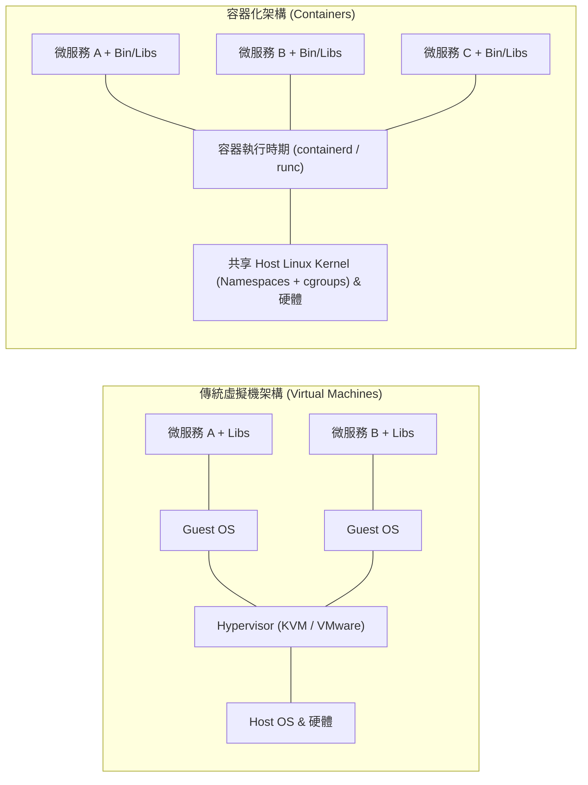

# 01. 微服務架構與容器化技術（Microservices & Containers）

微服務與容器化是現代雲原生（Cloud Native）架構的基石。微服務從**軟體架構層面**定義了如何拆解複雜業務；容器則從**作業系統與執行環境層面**定義了如何標準化封裝與隔離這些微服務。

---

## 一、 微服務架構（Microservices Architecture）

### 1. 從單體式（Monolith）到微服務的演進
在傳統單體式架構中，所有業務模組（如使用者管理、商品目錄、訂單處理、支付閘道）皆打包在同一個執行檔或處理程序（Process）中，並共享同一個資料庫。隨著業務規模擴大，單體架構會面臨：
- **變更風險高、交付週期長**：修改一行程式碼需要重新編譯、測試並部署整個系統。
- **擴展性受限（Scaling Bottleneck）**：當「秒殺活動」僅導致訂單模組負載飆升時，卻必須將整個單體應用複製多份，造成資源浪費。
- **技術債與技術棧鎖定**：難以針對不同模組特性選用最適合的程式語言或資料庫（例如推薦系統用 Python、高併發交易用 Go/Rust）。

**微服務架構的核心精神**：將單一應用程式開發為一組小型服務（Suite of Small Services），每個服務運行在自己獨立的處理程序中，圍繞**業務領域能力（Business Capability）**構建，並透過輕量級通訊機制互動。

### 2. 微服務拆分原則與領域驅動設計（DDD）
微服務切忌盲目求細（避免演變成難以維護的「奈米服務 Nanoservices」或「分散式單體 Distributed Monolith」）。業界標準做法是結合**領域驅動設計（Domain-Driven Design, DDD）**：
- **限界上下文（Bounded Context）**：明確定義每個領域模型的邊界，一個限界上下文通常對應一到多個微服務。
- **單一職責原則（SRP）與高內聚低耦合**：把因為相同原因而變更的邏輯放在同一個服務內，不同原因變更的邏輯拆開。
- **資料庫獨立原則（Database per Service）**：每個微服務獨佔自己的資料表或資料庫實例（Private Schema / DB），禁止其他微服務直接跨庫下 SQL JOIN，必須透過 API 或事件存取。

### 3. 微服務通訊模式（Communication Patterns）

| 通訊維度 | 同步通訊（Synchronous） | 非同步通訊（Asynchronous） |
| :--- | :--- | :--- |
| **核心機制** | 客戶端發起請求後阻塞等待回應（Request / Response） | 生產者發送訊息至 Broker 即返回，消費者非同步處理（Pub / Sub, Event Stream） |
| **主流協定與技術** | RESTful (HTTP/JSON)、**gRPC (HTTP/2 + Protobuf)**、GraphQL | **Apache Kafka**、RabbitMQ、NATS、Redis Streams |
| **優點** | 邏輯直觀、即時取得結果、易於實作強一致性流程 | 削峰填谷（Load Leveling）、高度解耦、提升系統整體可用性 |
| **缺點** | 呼叫鏈過長時延遲累加，下游故障易引發上游阻塞（雪崩效應） | 最終一致性（Eventual Consistency）設計複雜、除錯與追蹤難度高 |

### 4. 分散式交易與資料一致性：Saga 模式
由於每個微服務擁有獨立資料庫，傳統單庫的 ACID 本地交易不再適用，而兩階段提交（2PC / XA）在微服務下又因同步鎖定而嚴重影響吞吐量。因此微服務普遍採用 **Saga 模式** 實現最終一致性：
- **將長交易拆分為多個本地短交易（$T_1, T_2, \dots, T_n$）**，並為每個步驟定義對應的**補償交易（Compensating Transactions，$C_1, C_2, \dots, C_{n-1}$）**。
- 若 $T_k$ 執行失敗，系統依序逆向執行 $C_{k-1} \to \dots \to C_1$ 以撤銷先前的狀態變更。
- **兩種實作方式**：
  1. **協同式（Choreography）**：無中央協調者，各服務透過發布與訂閱領域事件（Domain Events）彼此觸發下一步或補償動作（適合步驟少、參與服務在 2~4 個以內的場景）。
  2. **編排式（Orchestration）**：由一個專門的 **Saga Orchestrator**（如 Temporal、Camunda 或自建狀態機）統一發送命令給各微服務，集中管理交易狀態與失敗回滾邏輯（適合複雜長流程）。

---

## 二、 容器化技術（Containerization）

如果每個微服務都部署在傳統虛擬機（Virtual Machine, VM）上，每個 VM 都需要運行完整的 Guest OS 核心，不僅啟動需要數分鐘，還會消耗數 GB 的額外記憶體。**容器（Containers）**透過作業系統層級的虛擬化（OS-level Virtualization），讓多個微服務共享同一個 Host Linux Kernel，同時保有高度隔離性。

### 1. Linux 容器的三大底層核心支柱

1. **Namespaces（命名空間 —— 負責「看得到什麼」的視角隔離）**
   - `PID Namespace`：隔離處理程序 ID（容器內的應用程式看到的自身 PID 為 1）。
   - `NET Namespace`：隔離網路介面（veth pair）、IP 位址、路由表與 Port 號。
   - `MNT Namespace`：隔離檔案系統掛載點。
   - `UTS Namespace`：隔離主機名稱（Hostname）與網域名稱。
   - `IPC Namespace`：隔離跨程序通訊資源（共享記憶體、信號量）。
   - `USER Namespace`：隔離使用者與群組 ID（實現 Rootless Container，容器內的 root 映射為主機上的普通非特權使用者）。

2. **Control Groups (`cgroups` —— 負責「能用多少」的資源限制與核算）**
   - 限制、統計並隔離處理程序群組對物理資源的使用量，包含 **CPU**（`cpu.cfs_quota_us` / `cpu.weight`）、**Memory**（硬上限與 OOM Killer 觸發）、**Block I/O**（磁碟讀寫頻寬）與 **Network I/O**。
   - 現代雲原生環境已廣泛升級至 **`cgroups v2`**，提供統一的階層式結構與更精準的記憶體壓力指標（PSI, Pressure Stall Information）。

3. **Union File System（聯合檔案系統，如 OverlayFS —— 負責「分層映像檔」的儲存效率）**
   - 容器映像檔由多個唯讀層（`LowerDir`，如 Base OS 層、Runtime 層、相依套件層）疊加而成。
   - 當容器啟動時，僅在最上方掛載一層極薄的可讀寫層（`UpperDir`），並採用 **寫入時複製（Copy-on-Write, CoW）** 機制：多個容器可共享同一份基礎映像檔頁快取（Page Cache），大幅節省磁碟空間並實現毫秒級啟動。

### 2. OCI 標準與現代容器執行時期（Container Runtime）架構
為了避免單一廠商鎖定，雲原生計算基金會（CNCF）與業界制定了 **OCI（Open Container Initiative）** 標準，包含映像檔規範（Image Spec）與執行時期規範（Runtime Spec）：
- **高階執行時期（CRI Runtime）**：如 **`containerd`** 與 **`CRI-O`**，直接實作 Kubernetes 的 CRI（Container Runtime Interface），負責映像檔拉取（Pull）、儲存管理與網路配置。
- **低階執行時期（OCI Runtime）**：如 **`runc`**（C 語言/Go 實作）或 **`crun`**（純 C 語言，更快速輕量），負責直接呼叫 Linux Kernel 建立 Namespaces 與 cgroups 並啟動容器程序。
- **安全沙箱容器（Sandboxed Containers）**：針對高安全性或多租戶場景，使用 **Kata Containers**（輕量級 MicroVM）或 **gVisor**（使用者空間核心），在容器速度與 VM 等級強隔離之間取得平衡。

---

## 三、 微服務 × 容器化的挑戰（引出後續章節）

當企業將數百個微服務全數容器化之後，立即會遇到四大新挑戰，這正是本知識庫後續四個章節要解決的核心議題：
1. **網路治理複雜度爆炸** $\rightarrow$ 需要 **服務網格（Service Mesh）**（見 `02_服務網格_Service_Mesh.md`）。
2. **異質負載與叢集資源碎片化** $\rightarrow$ 需要 **進階資源調度（Resource Scheduling）**（見 `03_資源調度_Resource_Scheduling.md`）。
3. **跨容器的連鎖故障與可觀測性碎片化** $\rightarrow$ 需要 **根因分析（Root Cause Analysis）**（見 `05_根因分析_Root_Cause_Analysis_與_AIOps整合.md`）。
4. **人工維運無法應對動態拓撲** $\rightarrow$ 需要 **多重代理系統（Multi-Agent System）** 自動化診斷與協作（見 `04_多重代理系統_Multi_Agent_System.md`）。
