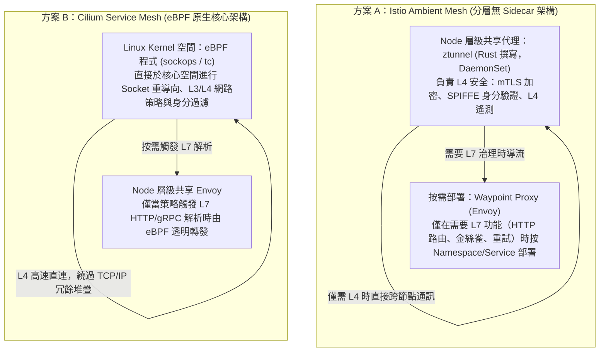

# 02. 服務網格（Service Mesh）架構與演進

在微服務架構中，服務與服務之間的「東西向流量（East-West Traffic）」極為頻繁。若將服務發現、負載平衡、逾時重試、熔斷、TLS 加密與分散式追蹤全部寫在業務程式碼或語言專屬的 SDK（如早期的 Netflix Hystrix/Ribbon）中，會導致多語言（Polyglot）維護困難且升級成本極高。

**服務網格（Service Mesh）** 的核心設計哲學是：**將微服務間的網路通訊、安全與可觀測性邏輯從應用程式碼中完全抽離，下沉成為雲原生基礎設施層（Infrastructure Layer）。**

---

## 一、 經典服務網格架構：控制平面 vs. 資料平面（以 Istio 為例）

服務網格在架構上嚴格分為兩大平面：

```mermaid
flowchart TB
    subgraph ControlPlane["控制平面 (Control Plane) — istiod"]
        direction LR
        Pilot["Pilot<br/>(服務發現與 xDS 流量規則轉譯)"]
        Citadel["Citadel<br/>(SPIFFE 憑證簽發與 mTLS 輪替)"]
        Galley["組態驗證與 API 處理<br/>(Gateway API / VirtualService)"]
    end

    subgraph DataPlane["資料平面 (Data Plane) — 攔截與轉發實際業務流量"]
        direction LR
        subgraph PodA["Pod A (訂單服務)"]
            AppA["訂單微服務容器"] <-->|localhost| EnvoyA["Envoy Sidecar Proxy"]
        end
        subgraph PodB["Pod B (庫存服務)"]
            EnvoyB["Envoy Sidecar Proxy"] <-->|localhost| AppB["庫存微服務容器"]
        end
        EnvoyA ===>|mTLS 加密東西向流量<br/>L7 路由 / 重試 / 熔斷 / 遙測| EnvoyB
    end

    ControlPlane -.->|xDS 協定 (LDS/RDS/CDS/EDS)<br/>非同步下發設定與憑證| EnvoyA
    ControlPlane -.->|xDS 協定 (LDS/RDS/CDS/EDS)<br/>非同步下發設定與憑證| EnvoyB
```

### 1. 資料平面（Data Plane）
- 直接處理微服務之間進出的每一個網路封包。
- 在經典模式中，以 **Sidecar Proxy（伴車代理，主流為 Envoy）** 的形式注入到每一個 Kubernetes Pod 中，與業務容器並存。
- 負責執行：動態服務發現、負載平衡（Round Robin / Least Request / 一致性雜湊）、TLS 終止與雙向加密（mTLS）、HTTP/2 與 gRPC 流量路由、熔斷器（Circuit Breaker）、健康檢查、故障注入（Fault Injection）以及指標/日誌/追蹤資訊的生成。

### 2. 控制平面（Control Plane，如 Istio 的 `istiod`）
- **不直接接觸任何業務封包**，而是作為整個網格的「大腦」。
- 負責將運維人員宣告的高階 YAML 策略（如 Kubernetes **Gateway API**、Istio `VirtualService`、`DestinationRule`、`AuthorizationPolicy`）編譯為 Envoy 能理解的 **xDS 協定組態**（Listener、Route、Cluster、Endpoint Discovery Service），並動態推送給所有資料平面代理。
- 內建 CA（憑證授權中心），基於 **SPIFFE（Secure Production Identity Framework for Everyone）** 標準為每個工作負載簽發短期 X.509 憑證，實現自動化金鑰輪替。

---

## 二、 架構演進：從 Sidecar 模式走向無 Sidecar（Sidecarless / Ambient & eBPF）

### 1. 傳統 Sidecar 模式的痛點
雖然 Sidecar 實現了業務無侵入，但在超大規模叢集中暴露出明顯缺陷：
- **資源開銷龐大（Memory & CPU Bloat）**：每個 Pod 都要額外跑一個 Envoy 容器（佔用 50MB~100MB+ 記憶體）。若叢集有 5,000 個 Pod，光是 Sidecar 就消耗數百 GB 記憶體。
- **延遲增加**：每次跨服務呼叫都必須經過「容器 A $\to$ iptables/Envoy A $\to$ 網路 $\to$ iptables/Envoy B $\to$ 容器 B」，增加兩次使用者空間（User-space）代理跳躍與序列化開銷。
- **生命週期耦合**：升級 Envoy 版本需要滾動重啟所有業務 Pod；Job 類型的短生命週期 Pod 常因 Sidecar 尚未就緒或未退場而卡住（Race Condition）。

### 2. 現代無 Sidecar（Sidecarless）兩大主流架構



| 比較維度 | 傳統 Sidecar 模式 (Istio Classic) | Istio Ambient Mesh (無 Sidecar) | Cilium Service Mesh (eBPF 原生) |
| :--- | :--- | :--- | :--- |
| **代理部署粒度** | **Per-Pod**（每個業務 Pod 注入一個 Envoy） | **Per-Node** L4 (`ztunnel`) + **按需 Per-Namespace/Service** L7 (`Waypoint`) | **Kernel eBPF** (L3/L4) + **Per-Node** 共享 Envoy (L7) |
| **L4 安全與加密** | Envoy Sidecar 處理 mTLS | 由極輕量的 Rust 代理 **`ztunnel`** 透過 HBONE (HTTP CONNECT) 隧道處理 mTLS | 透過 eBPF Maps 搭配 WireGuard / IPsec 在核心層透明加密 |
| **記憶體與 CPU 成本** | 高（隨 Pod 數量線性增長） | **極低**（節省 70%~90% 代理記憶體開銷） | **極低**（L4 完全在 Linux Kernel 內完成） |
| **應用 Pod 侵入性** | 需重啟 Pod 注入 Sidecar 容器 | **零侵入**（無需重啟業務 Pod 即可動態納管進網格） | **零侵入**（CNI 與網格合一） |

---

## 三、 服務網格的核心治理能力（與資源調度及 RCA 的連動點）

### 1. 精細化流量管理（Traffic Management）
- **金絲雀發布（Canary Release）與藍綠部署**：按權重（如 95% `v1` / 5% `v2`）或按 HTTP Header（如特定測試使用者、特定地區）精準切分流量。
- **韌性機制（Resiliency）**：
  - **逾時與重試（Timeouts & Retries）**：設定單次呼叫逾時與退避重試（Exponential Backoff），防止短暫網路抖動導致失敗。
  - **熔斷與異常點驅逐（Circuit Breaking & Outlier Detection）**：當下游某個 Pod 連續返回 `5xx` 錯誤或連線數超標時，自動將該實例從負載平衡池中暫時隔離（Ejection）一段時間，防止故障擴散（Cascading Failure）。
- **混沌工程與故障注入（Fault Injection）**：主動在特定路由注入延遲（如 5 秒延遲）或錯誤（HTTP 503），用於驗證微服務架構與多重代理 RCA 系統的韌性。

### 2. 零信任安全網路（Zero-Trust Security）
- **雙向 TLS（Strict mTLS）**：所有東西向通訊強制加密，並利用 `spiffe://<trust-domain>/ns/<namespace>/sa/<service-account>` 驗證呼叫方與被呼叫方的加密身分，而非依賴不可靠的 Pod IP。
- **細粒度授權策略（`AuthorizationPolicy`）**：在 L4/L7 層級精確限制「只允許 `checkout-service` 對 `payment-service` 的 `/api/v1/charge` 路徑發起 `POST` 請求」。

### 3. 統一可觀測性（Observability —— 為 RCA 提供黃金數據）
服務網格是 **根因分析（RCA）** 最重要的數據來源之一，因為所有流量都經過代理，無需修改業務程式碼就能統一產出：
- **黃金四指標（Four Golden Signals）**：自動收集每條服務邊（Service Edge）的 **延遲（Latency）**、**流量（Traffic / QPS）**、**錯誤率（Errors）** 與 **飽和度（Saturation）**（例如 Istio 標準指標 `istio_requests_total`、`istio_request_duration_milliseconds`）。
- **自動化服務拓撲圖（Service Topology Graph）**：即時繪製「哪個微服務正在呼叫哪個微服務」的有向圖（如 Kiali），為後續多重代理 RCA 提供精確的**因果依賴圖（Causal Dependency Graph）**。
- **分散式追蹤上下文傳遞（Trace Context Propagation）**：自動生成或轉發 W3C Trace Context / B3 Headers，串聯完整呼叫鏈。
