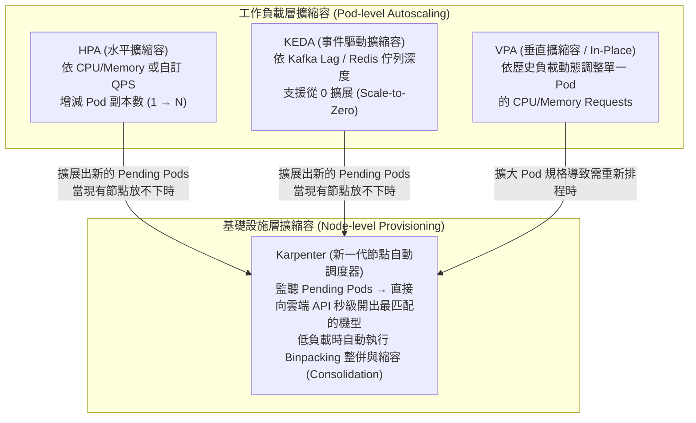

# 03. 雲原生資源調度與彈性擴縮容（Resource Scheduling & Autoscaling）

在微服務與容器化環境中，數以千計的容器與 AI/資料處理任務共同運行於共享的伺服器叢集（Kubernetes Cluster）中。**資源調度（Resource Scheduling）**的核心目標是：**在滿足服務等級目標（SLO，如低延遲、高可用）的前提下，將工作負載（Pods）分配至最合適的運算節點（Nodes），最大化硬體資源利用率並防止資源爭搶（Resource Contention / Noisy Neighbor）。**

---

## 一、 Kubernetes 核心排程器（`kube-scheduler`）運作機制

當一個 Pod 被建立且尚未指定 `nodeName` 時，`kube-scheduler` 會從排程佇列（Scheduling Queue）中取出該 Pod，並經過兩個主要階段完成排程：

```mermaid
flowchart LR
    PendingPod["待排程 Pod<br/>(Pending Queue)"] --> PreFilter["1. PreFilter / Filter<br/>(過濾階段 / Predicates)"]
    PreFilter -->|篩除資源不足、Taint 不符、<br/>Port 衝突的節點| FeasibleNodes["可行節點集合<br/>(Feasible Nodes)"]
    FeasibleNodes --> Score["2. PreScore / Score<br/>(評分階段 / Priorities)"]
    Score -->|計算親和性、資源均衡度、<br/>映像檔快取分數 (0~100)| BestNode["選出最高分節點"]
    BestNode --> Bind["3. Reserve & Bind<br/>(綁定階段，寫入 etcd)"]
```

### 1. 過濾階段（Filtering / Predicates）：找出「能不能跑」的節點
排程器並行檢查叢集中的所有節點，剔除不符合硬性條件的節點：
- **`PodFitsResources`**：節點剩餘的可分配資源（Allocatable CPU / Memory）是否大於或等於該 Pod 的 `requests`？
- **`NodeResourcesFit` / `NodePorts`**：節點上是否還有空閒的 HostPort？
- **`NodeAffinity` & `NodeSelector`**：節點標籤（Labels）是否符合 Pod 的硬性親和性（`requiredDuringSchedulingIgnoredDuringExecution`）？
- **`PodTopologySpread` & `InterPodAffinity`**：是否滿足跨可用區（AZ）或跨機架的反親和性（Anti-Affinity）高可用容災要求？
- **`TaintToleration`**：節點若有汙點（Taints，例如 GPU 專用節點或即將維護的節點），Pod 是否具備對應的容忍度（Tolerations）？

### 2. 評分階段（Scoring / Priorities）：找出「最適合跑」的節點
通過過濾的節點會由多個評分外掛（Scoring Plugins）各自打出 `0` 到 `100` 的分數，乘以權重後加總，由最高分的節點勝出：
- **`NodeResourcesFit`（資源分配策略）**：
  - `LeastAllocated`（預設）：優先選擇空閒資源較多的節點，將負載分散（Spreading），適合延遲敏感的線上微服務。
  - `MostAllocated`（Binpacking 裝箱策略）：優先把 Pod 塞進已經較滿的節點，騰出整台空節點以便縮容釋放雲端機器，適合批次任務或成本最佳化。
- **`NodeResourcesBalancedAllocation`**：優先選擇放入該 Pod 後「CPU 使用率」與「Memory 使用率」比例最接近的節點，避免出現「CPU 已滿但記憶體還剩 80%」的資源碎片化（Resource Stranding）。
- **`ImageLocality`**：優先選擇本地已經快取（Cached）該容器映像檔的節點，省去下載映像檔時間，加速 Pod 啟動。

---

## 二、 容器資源模型與服務品質等級（QoS Classes）

Kubernetes 透過每個容器宣告的 `requests` 與 `limits` 來配置底層 Linux `cgroups`，並自動為 Pod 劃分三種 **QoS（Quality of Service）等級**，這直接決定了節點發生資源壓力（尤其是記憶體耗盡觸發 OOM Killer）時的**驅逐順序（Eviction Order）**：

| QoS 等級 | 判定條件 | 底層 `cgroups` 與排程行為 | 節點資源耗盡時的驅逐優先級 | 適用場景 |
| :--- | :--- | :--- | :--- | :--- |
| **`Guaranteed`**<br/>（完全保障型） | Pod 內每個容器皆設定 CPU 與 Memory 的 `requests` 與 `limits`，且 **`requests == limits`** | 獨佔穩定配額，可搭配 `static` CPU Manager 策略綁定實體 CPU 核心（CPU Pinning），消除上下文切換抖動 | **最後才被驅逐**（OOM 分數 `oom_score_adj = -997`，保護級別最高） | 核心交易微服務、資料庫、訊息佇列、控制平面元件 |
| **`Burstable`**<br/>（彈性突發型） | 不符合 Guaranteed，但至少有一個容器設定了 CPU 或 Memory 的 `requests`（通常 **`requests < limits`**） | 排程器按 `requests` 預留保底資源；節點有閒置資源時允許突發使用至 `limits` | **中等風險**（依實際記憶體佔用比例計算 `oom_score_adj`，介於 `2` 到 `999`） | 一般多數 Web 微服務、API Gateway、後台管理服務 |
| **`BestEffort`**<br/>（盡力而為型） | Pod 內所有容器皆**未設定**任何 `requests` 與 `limits` | 僅能使用節點剩下的零碎資源 | **最先被驅逐/OOMKill**（`oom_score_adj = 1000`） | 可隨時中斷重跑的開發測試任務、低優先級離線腳本 |

> **工程實務重要建議（CPU Limit 陷阱）**：
> - **Memory Limit 必須設定**：防止單一微服務發生記憶體洩漏（Memory Leak）時吃光整台節點記憶體，拖垮同節點的其他服務。
> - **CPU Request 必須設定，但 CPU Limit 需謹慎評估**：因為 CPU 是「可壓縮資源（Compressible Resource）」，若設定過嚴格的 CPU Limit，當多執行緒微服務（如 Java/Go）瞬間高併發時，即使節點還有大量閒置 CPU，Linux CFS 配額機制（CFS Quota）也會強制對該容器進行 **CPU Throttling（節流）**，導致微服務 P99 尾端延遲（Tail Latency）暴增。

---

## 三、 多維度彈性擴縮容體系（Autoscaling Ecosystem）

靜態的資源分配無法應對真實世界的流量波峰與波谷。現代雲原生架構採用四層協同擴縮容：



1. **HPA（Horizontal Pod Autoscaler）**：根據指標自動調整副本數量：
   $$\text{DesiredReplicas} = \left\lceil \text{CurrentReplicas} \times \frac{\text{CurrentMetricValue}}{\text{DesiredMetricValue}} \right\rceil$$
2. **KEDA（Kubernetes Event-driven Autoscaling）**：彌補標準 HPA 的不足，直接對接外部事件源（如 Kafka Topic 訊息堆積量、RabbitMQ、Prometheus 查詢、Cron 時間表），並支援無流量時縮減至 `0` 個副本（Scale to Zero）。
3. **VPA（Vertical Pod Autoscaler）與 In-Place Pod Vertical Scaling**：自動分析容器實際資源消耗並修正 `requests`/`limits`。新版 Kubernetes 支援 **原地垂直擴縮容（In-Place Resizing）**，無需重啟容器即可動態修改 `cgroups` 配額。
4. **Karpenter（無群組節點自動供應器）**：取代傳統緩慢的 Cluster Autoscaler（需預先配置固定規格的 Node Group）。Karpenter 直接觀察未排程 Pod 的匯總需求（CPU、記憶體、架構 `amd64`/`arm64`、Spot/On-Demand、GPU），在數十秒內直接呼叫雲端供應商 API 啟動成本最低、最契合的實例規格，並在離峰時自動進行節點碎片整理（Consolidation）。

---

## 四、 批次與 AI/多代理工作負載排程：Volcano

當叢集中除了線上微服務，還運行著 **多重代理系統（Multi-Agent LLM 推論/微調）**、PyTorch 分散式訓練、Ray 或 Spark 任務時，標準 `kube-scheduler` 「一次排程一個 Pod」的模式會遭遇死鎖（Deadlock）。因此常引入 CNCF 的 **Volcano** 排程器：
- **Gang Scheduling（成組排程 / All-or-Nothing）**：若一個分散式任務需要 8 個 Worker Pods 同時協作，只有在叢集能同時滿足全部 8 個 Pods 的資源時才一起啟動；若只夠跑 5 個，則全部等待，避免佔著資源卻無法推進的死鎖。
- **Fair-Share 與 DRF（Dominant Resource Fairness，主導資源公平演算法）**：在多個團隊共享 CPU、Memory 與 GPU 等多維度資源時，確保每個佇列（Queue）獲得公平的配額，並支援高低優先級搶佔（Preemption）與借用回收（Reclaim）。
