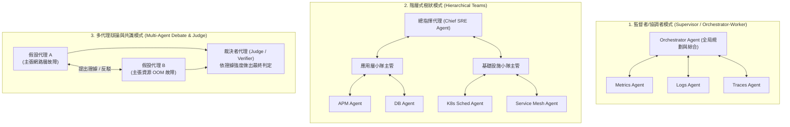

# 04. 多重代理系統（Multi-Agent Systems, MAS）原理與架構

隨著大型語言模型（LLM）具備強大的推理與工具呼叫能力，AI 系統的設計範式已從「單一模型問答（Zero-shot / Prompting）」演進為「自主代理（Autonomous Agent）」，並進一步發展為由多個專職代理協同解決複雜工程問題的 **多重代理系統（Multi-Agent Systems, MAS）**。

在微服務架構治理、雲原生資源調度與根因分析（RCA）中，MAS 是實現高度自主化智慧維運（Agentic AIOps）的核心引擎。

---

## 一、 單一 AI 代理（Single Agent）的四大核心組件

在理解多重代理之前，每一個獨立的智慧代理（Agent）皆由以下四個模組構成（經典公式：$\text{Agent} = \text{LLM} + \text{Planning} + \text{Memory} + \text{Tool Use}$）：

1. **核心大腦（LLM Backbone）**
   - 負責語意理解、邏輯推理、指令遵循與決策生成。在工程實務中，常依任務複雜度混用高階推理模型（負責全局規劃）與輕量高速模型（負責高頻率的日誌篩選或指標提取）。
2. **規劃與推理機制（Planning & Reasoning）**
   - **子目標拆解（Task Decomposition）**：將複雜目標（例如：「排查為何結帳微服務延遲飆高」）拆解為可執行的子步驟。
   - **ReAct（Reason + Act）迴圈**：交替執行「思考（Thought）$\to$ 採取行動呼叫工具（Action）$\to$ 觀察工具回傳結果（Observation）」，動態修正下一步。
   - **自我反思與檢討（Reflection & Self-Criticism）**：對初步生成的假設或操作指令進行事後驗證，檢查是否有邏輯漏洞或違反安全約束。
3. **記憶系統（Memory System）**
   - **短期記憶（Short-term / Working Memory）**：當前對話視窗（Context Window）與多代理之間的共享狀態（Shared State / Scratchpad）。
   - **長期記憶（Long-term / Episodic & Semantic Memory）**：透過向量資料庫（Vector DB）與知識圖譜（Knowledge Graph）儲存歷史故障案例（Post-mortems）、標準作業程序（SOP / Runbooks）與系統架構文件，透過 **RAG（檢索增強生成）** 隨時調用。
4. **工具使用與環境互動（Tool Use & MCP）**
   - 代理透過 Function Calling 或 **MCP（Model Context Protocol，模型上下文協定）** 連接外部真實系統，例如：查詢 Prometheus API、檢索 Loki 日誌、執行 `kubectl describe/get`、讀取 Istio 路由設定等。

---

## 二、 為什麼需要「多重代理（Multi-Agent）」而非單一超級代理？

在雲原生微服務環境中，如果把所有監控指標、數萬行日誌、分散式追蹤 Span 以及數十個工具 API 全部塞給**同一個單一 Agent**，會立刻遭遇三大瓶頸：
1. **上下文視窗飽和與「迷失於中間（Lost in the Middle）」**：海量異質遙測資料會稀釋注意力機制，導致模型忽略關鍵錯誤訊息。
2. **工具選擇混亂（Tool Overload）**：當單一 Agent 掛載超過 20~30 個跨領域工具時，模型選錯工具或填錯參數的機率急遽上升。
3. **過早收斂與確認偏誤（Confirmation Bias）**：單一 Agent 容易被最早看到的一個表面異常（如 API Gateway 報 504 Timeout）誤導，直接下結論，而未深入排查底層真正的根因。

**多重代理系統（MAS）透過「分而治之（Divide and Conquer）」與「多視角交叉驗證」完美解決上述問題。**

---

## 三、 多重代理協作拓撲模式（MAS Collaboration Topologies）

根據任務性質，多重代理系統可設計為以下四種主流協作架構：

### 1. 監督者/協調者模式（Supervisor / Orchestrator-Worker）
- 由一個中央 **Orchestrator Agent** 接收告警，動態拆解查詢任務並分派給底層專職的 **Worker Agents**（如指標代理、日誌代理、追蹤代理）。
- Worker 只在自己獨立的上下文（Isolated Context）中處理原始高噪聲數據，僅將**精煉後的摘要與證據（Distilled Findings）**回傳給 Orchestrator，大幅節省 Token 並維持主上下文乾淨。

### 2. 階層式模式（Hierarchical Architecture）
- 當系統規模跨越數千個微服務與多個 K8s 叢集時，採用多層次管理：頂層為全局協調代理，中層為各子系統主管代理（如網路服務網格主管、資料庫主管、K8s 計算調度主管），底層為具體執行工具查詢的專家代理。

### 3. 多代理辯論與對抗驗證（Multi-Agent Debate & Adversarial Verification）
- 針對高模糊度的複雜故障，讓多個代理分別持不同假設展開多輪辯論（Debate），互相指出對方證據鏈中的矛盾（例如：「若真是資料庫鎖死，為何只有節點 A 上的 Pod 報錯，而節點 B 上的 Pod 正常？」），最後由 **Judge Agent（裁判代理）** 收斂出最符合所有觀測事實的結論，顯著降低 AI 幻覺（Hallucination）。

### 4. 進階搜尋推理：語言代理樹狀搜尋（LATS, Language Agent Tree Search）
- 結合 **蒙地卡羅樹搜尋（MCTS, Monte Carlo Tree Search）** 與多重代理：將問題排查視為一棵決策樹，包含 **選擇（Selection）$\to$ 擴展假設（Expansion）$\to$ 執行工具模擬（Simulation）$\to$ 反思評分（Reflection/Evaluation）$\to$ 反向傳播更新價值（Backpropagation）**。當某條調查分支走入死胡同時，系統能自動回溯（Backtrack）並探索其他高潛力分支。

---

## 四、 主流多重代理開發框架對照

| 框架名稱 | 核心設計抽象 | 狀態管理與控制流特色 | 在雲原生與 AIOps 中的適用場景 |
| :--- | :--- | :--- | :--- |
| **LangGraph** | **有向圖狀態機（StateGraph）**（節點為 Agent/函式，邊為條件跳轉） | 具備強型別共享狀態（Typed State）、支援迴圈（Cycles）、斷點續傳（Checkpointing）與人工介入審批（Human-in-the-Loop） | **生產級首選**：適合需要嚴謹控制診斷流程、樹狀搜尋回溯與自動化修復審批的企業級 RCA 系統 |
| **Microsoft AutoGen** | **事件驅動與對話式多代理（Conversable Agents）** | 彈性支援雙代理對話、GroupChat、巢狀對話與程式碼沙箱執行 | 適合動態探索型任務、多代理腦力激盪辯論（Debate）與自動撰寫診斷腳本 |
| **CrewAI** | **角色扮演與任務流水線（Roles, Tasks, Crews）** | 宣告式定義每個 Agent 的角色（Role）、目標（Goal）與背景（Backstory） | 適合快速搭建結構固定的標準維運巡檢流程與自動化報告生成 |
| **MCP (Model Context Protocol)** | **標準化工具與上下文連接協定**（Client-Server 架構） | 解耦「AI 代理框架」與「底層工具（K8s、Prometheus、Istio、GitHub）」 | 作為所有專業代理連接雲原生基礎設施的統一安全介面 |
