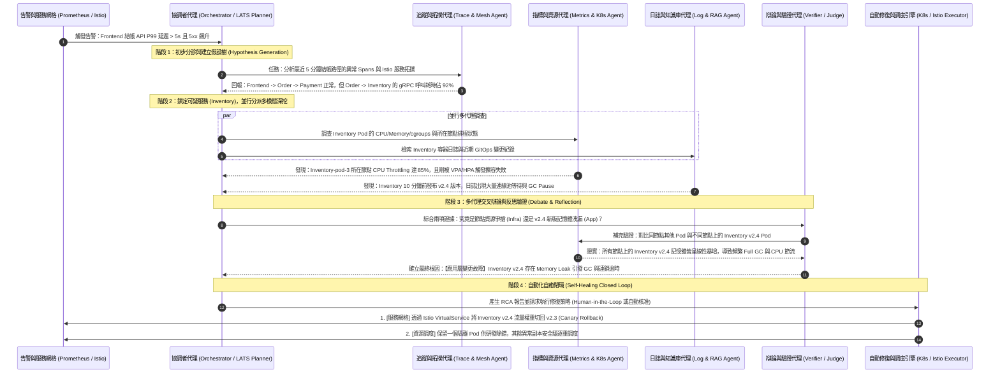

# 05. 根因分析（Root Cause Analysis, RCA）與多重代理 AIOps 整合

在微服務、容器化、服務網格與動態資源調度共同構建的雲原生環境中，系統具備極高的彈性，但也帶來了極高的**動態複雜度**。當系統發生異常時，如何從成千上萬條告警中迅速定位真正的病灶（Root Cause），並聯動資源調度與服務網格完成修復，是現代 SRE 與 AIOps 的核心命題。

---

## 一、 為什麼微服務架構下的根因分析（RCA）如此困難？

### 1. 故障傳播與警報海嘯（Fault Propagation & Alert Storms）
在微服務呼叫鏈 $A \to B \to C \to \text{DB}$ 中，故障傳播方向與呼叫方向往往**相反**：
- **真因（Root Cause）**：底層某個 Kubernetes 節點發生磁碟 I/O 降級，或微服務 $C$ 的容器因記憶體不足觸發頻繁 GC / CPU Throttling。
- **連鎖反應（Cascading Failure）**：微服務 $C$ 回應變慢 $\to$ 微服務 $B$ 的連線池耗盡 $\to$ 微服務 $A$ 與 API Gateway 大量返回 `HTTP 503 / 504` $\to$ Prometheus 在一分鐘內同時觸發 200 條告警（Alert Storm）。
- 若僅看表面告警，很容易誤將受害最深的「上游 API Gateway（Hub 節點）」當成罪魁禍首。

### 2. 多模態可觀測性三支柱（Three Pillars of Observability）的資料碎片化
要精準定位根因，必須同時交叉比對三種不同維度的遙測資料，外加控制平面事件：

| 資料模態 | 回答的核心問題 | 常見採集工具 | 在 RCA 中的作用與侷限 |
| :--- | :--- | :--- | :--- |
| **Metrics（指標）** | **「什麼時候壞了？影響範圍多大？」** | Prometheus, VictoriaMetrics, cAdvisor, Envoy Stats | 能毫秒級反映 QPS、延遲（P99）、CPU/Memory 與錯誤率趨勢；但缺乏單一請求的具體錯誤上下文 |
| **Traces（分散式追蹤）** | **「壞在哪一條呼叫路徑與哪一個服務？」** | OpenTelemetry, Jaeger, Tempo, Zipkin | 透過 `TraceID` 與 `SpanID` 還原跨服務呼叫鏈與耗時拆解，精準定位瓶頸微服務（Bottleneck Span） |
| **Logs（日誌）** | **「為什麼壞了？具體的錯誤原因為何？」** | FluentBit, Loki, Elasticsearch | 記錄 Stack Trace（如 `NullPointerException`、`ConnectionPoolExhausted`、SQL Deadlock）；但資料量極大、雜訊多 |
| **Cluster Events & Topology（叢集事件與拓撲）** | **「近期基礎設施或設定發生了什麼變化？」** | Kubernetes Events, ArgoCD GitOps 紀錄, Istio/Kiali 拓撲 | 揭示 `OOMKilled`、Pod Eviction、Node Pressure、最新映像檔發布或服務網格路由規則變更 |

---

## 二、 根因分析技術的演進：從傳統演算法到多重代理系統（MAS-RCA）

### 第一代：基於拓撲與統計因果圖的傳統 AIOps（Graph & Statistical RCA）
- **機制**：利用分散式追蹤或服務網格建構服務依賴圖（Service Dependency Graph），結合 **PC 演算法 / Granger 因果檢定** 建立因果圖（Causal Graph），再透過 **PageRank / Random Walk（隨機漫步）** 尋找異常傳播起點（如 MicroRCA、CausalRCA）。
- **侷限**：僅能處理數值型指標（Metrics），**完全無法讀懂非結構化的錯誤日誌（Logs）、程式碼變更或 Kubernetes 事件語意**，且在跨層故障（例如容器排程不當引發的應用層超時）中準確率偏低。

### 第二代：單一 LLM 提示詞診斷（Single-Agent / Linear LLM RCA）
- **機制**：將告警發生前後的 Metrics、Logs、Traces 全部拼接到一個 Prompt 中詢問 LLM，或使用單一 ReAct Agent 逐步查詢。
- **侷限**：極易發生 Context Window 溢位、Token 成本高昂，且採用「線性推理（Linear Reasoning）」——一旦第一步假設錯誤（例如先查了無關的日誌），就會一路順著錯誤方向推理下去，無法有效回溯。

### 第三代：多重代理協同根因分析（Multi-Agent System RCA，如 LATS-RCA、K-MAS）
結合 **專職領域代理分工（Domain-Specific Agents）** 與 **樹狀搜尋/辯論機制（Tree Search & Debate）**，是目前學術界與工業界最先進的雲原生 RCA 架構。

---

## 三、 現代多重代理根因分析（MAS-RCA）完整運作流程

以下展示當微服務叢集發生故障時，多重代理系統如何協同定位根因並觸發自動修復：

---

## 四、 六大主題的終極閉環：從「偵測診斷」到「網格與調度自癒」

當多重代理完成根因分析（RCA）後，不僅僅是產出一份人類可讀的診斷報告，更能與前面章節介紹的 **服務網格（Service Mesh）** 與 **資源調度（Resource Scheduling）** 形成**自動化控制閉環（Autonomous Self-Healing Loop）**：

| 診斷出的根因類別 (Root Cause Category) | 服務網格（Service Mesh）連動修復動作 | 容器與資源調度（K8s Scheduling）連動修復動作 |
| :--- | :--- | :--- |
| **1. 新版本程式碼瑕疵 / 記憶體洩漏** （如金絲雀版本異常） | 透過 Istio `VirtualService` **毫秒級將 100% 流量切回穩定舊版（v1）**，無需等待容器重新部署 | 自動觸發 Argo Rollouts / Deployment 回滾，並凍結問題版本的自動擴縮容 |
| **2. 單一微服務實例卡死或局部節點網路劣化** （Gray Failure / 灰故障） | 調緊 Istio `DestinationRule` 的 **Outlier Detection（異常實例驅逐）** 與熔斷閾值，立即隔離故障 Pod | 對問題節點加上 `NoSchedule` 汙點（Taint / Cordon），並透過 `kube-scheduler` 將 Pod 重新排程至健康節點 |
| **3. 突發流量洪峰與資源配置不足** （CPU Throttling / OOMKilled） | 啟用 Envoy 本地速率限制（Rate Limiting）與非核心服務降級策略，保護核心交易鏈路 | 動態調高 **HPA/KEDA** 副本上限，或透過 **VPA 原地調整（In-Place Resize）** 提高容器 CPU/Memory Limits，並由 **Karpenter** 秒級擴充底層節點 |
| **4. 鄰居噪音與異質負載爭搶** （Noisy Neighbor，如 AI 批次任務搶佔微服務資源） | 根據延遲指標將受影響節點的流量權重調降（Locality Weight Load Balancing） | 調整 Pod **QoS 等級**（將核心微服務提升為 `Guaranteed`），並透過 **Volcano** 排程器限制批次佇列配額或將離線任務驅逐（Preemption） |

---

## 五、 評估根因分析系統的關鍵量化指標

在學術研究與企業落地評估多重代理 RCA 系統（例如使用 RCAEval、TrainTicket、Online Boutique 等微服務基準測試集）時，通常採用以下指標：

1. **Top-$k$ 準確率（$\text{AC@}k$ / $\text{Hit@}k$）**：
   真實根因微服務（或根因指標類型）出現在系統預測的前 $k$ 個候選名單中的比例（常見如 $\text{AC@1}$、$\text{AC@3}$、$\text{AC@5}$）：
   $$\text{AC@}k = \frac{1}{|A|} \sum_{a \in A} \mathbb{I}\left(\text{rank}(rc_a) \le k\right)$$
2. **平均排名分數（$\text{Avg@}k$）**：
   綜合衡量排名前 $k$ 的精確度，排名越靠前得分越高：
   $$\text{Avg@}k = \frac{1}{k} \sum_{j=1}^{k} \text{AC@}j$$
3. **平均偵測與診斷時間（MTTD / MTTI）與平均修復時間（MTTR）**：
   評估從異常注入到多重代理收斂出正確根因所需的延遲（Latency）與消耗的 LLM Token 成本。
