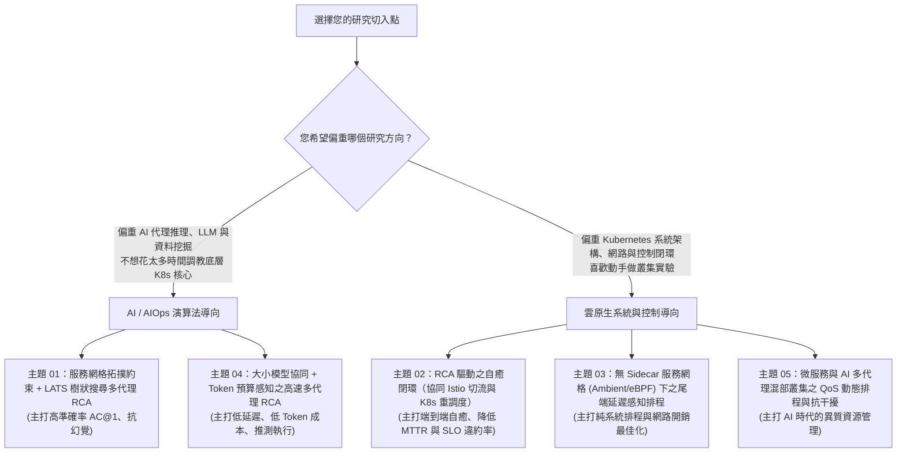

# 研究主題總覽與選題指南（含標準實驗平台與資料集）

本目錄將**微服務（Microservices）**、**容器（Containers）**、**服務網格（Service Mesh）**、**資源調度（Resource Scheduling）**、**多重代理（Multi-Agent Systems, MAS）**與**根因分析（Root Cause Analysis, RCA）**六大元素交叉組合，提煉出 **5 個極具學術發表潛力（碩博士論文、頂會/期刊如 ICSE、FSE、ASE、EuroSys、SOCC、INFOCOM、IEEE TSC/TNSM）的研究主題**，並分別獨立成檔。

---

## 一、 五大研究主題導覽與選題比較矩陣

| 檔案連結 | 研究主題名稱 | 涵蓋的核心技術組合 | 適合的研究取向 | 實作難度 / 硬體需求 |
| :--- | :--- | :--- | :--- | :--- |
| **[研究主題_01](./研究主題_01_結合服務網格拓撲與樹狀搜尋之多重代理根因分析.md)** | **結合服務網格動態拓撲與樹狀搜尋之多重代理微服務根因分析** | 微服務 + 服務網格遙測 + 多重代理 + RCA | AI 演算法 / 軟體工程 (SE) / AIOps | ⭐⭐⭐（可直接使用公開資料集 `RCAEval` + LLM API，不一定需要自建大型 K8s 叢集） |
| **[研究主題_02](./研究主題_02_根因驅動之自主自癒閉環_服務網格切流與K8s動態資源重調度.md)** | **根因驅動之雲原生自主自癒閉環：協同服務網格流量控制與 K8s 動態資源重調度** | 六大主題全滿貫（RCA $\to$ MAS 決策 $\to$ Mesh 切流 + K8s 調度） | 系統與控制閉環 / 雲原生自治系統 | ⭐⭐⭐⭐（需在 K8s 上部署微服務 Benchmark 並結合 ChaosMesh 驗證 MTTR 降幅） |
| **[研究主題_03](./研究主題_03_無Sidecar服務網格_Ambient與eBPF_下之微服務尾端延遲感知資源調度.md)** | **無 Sidecar 服務網格（Ambient Mesh 與 eBPF）架構下之微服務尾端延遲感知資源調度** | 微服務 + 容器 + 服務網格 (Ambient/eBPF) + 資源調度 | 雲端系統 / 網路與容器排程 (Systems & Networking) | ⭐⭐⭐⭐（偏重系統底層效能分析、Linux Kernel eBPF/ztunnel 開銷建模與排程演算法） |
| **[研究主題_04](./研究主題_04_大小模型協同與預算感知之低成本多重代理即時根因定位.md)** | **大小模型協同與 Token 預算感知之低延遲多重代理微服務根因定位** | 微服務 + 多重代理 (SLM + LLM) + 推論資源調度 + RCA | 高效率 AI 系統 (Efficient AI / Agentic Systems) | ⭐⭐⭐（聚焦解決多代理 RCA「太慢、太貴」的痛點，非常容易做出漂亮的帕累托前沿圖） |
| **[研究主題_05](./研究主題_05_AI代理與線上微服務混部叢集之QoS感知動態排程與抗干擾機制.md)** | **線上微服務與多重代理 AI 推論混部叢集之 QoS 感知資源調度與根因抗干擾機制** | 容器 `cgroups` + 資源調度 (K8s/Volcano) + 多重代理負載 + 微服務 SLO | 叢集資源管理 / 分散式系統排程 | ⭐⭐⭐⭐（探討 AI Agent 突發流量與微服務混部時的 Noisy Neighbor 偵測與動態隔離） |

---

## 二、 領域通用標準實驗平台、測試系統與資料集（必備工具箱）

在撰寫上述任何一個主題的論文時，審稿人（Reviewers）最看重的是**「是否在公認的微服務基準系統（Benchmarks）與真實故障注入（Chaos Engineering）下進行評估」**。以下是目前 2024–2026 頂會論文最常使用的標準組件：

### 1. 標準開源微服務基準測試系統（Target Microservice Benchmarks）
1. **TrainTicket (`FudanSELab/train-ticket`)**
   - **規模**：包含 **41+ 個微服務** 的火車訂票系統，涵蓋 Java (Spring Boot)、Node.js、Python、Go 與 MongoDB/MySQL、RabbitMQ。
   - **特色**：目前軟體工程與 AIOps 頂會（ICSE/FSE/ASE）使用率第一的大型微服務測試床，呼叫鏈深且包含真實業務邏輯。
2. **Online Boutique (`GoogleCloudPlatform/microservices-demo`)**
   - **規模**：由 Google 開源的 **11 個微服務** 雲原生電商系統（使用 gRPC 通訊，涵蓋 Go、C#、Node.js、Python、Java）。
   - **特色**：輕量、部署極快，原生支援 Istio 服務網格與 OpenTelemetry，最適合快速驗證原型與服務網格切流實驗。
3. **DeathStarBench (`delimitrou/DeathStarBench`)**
   - **規模**：Cornell 大學開發的微服務基準套件（包含社群網路 Social Network、飯店預訂 Hotel Reservation、媒體服務 Media Microservices）。
   - **特色**：系統領域頂會（ASPLOS、OSDI、EuroSys、SOCC）最常採用的微服務效能、尾端延遲（P99 Latency）與資源調度測試床。

### 2. 標準故障注入與混沌工程工具（Fault Injection）
- **Chaos Mesh (`chaos-mesh/chaos-mesh`)** 或 **LitmusChaos**：
  - 原生運行於 Kubernetes，可透過宣告式 YAML 自動注入：
    - **容器/資源層故障**：CPU Stress（CPU 飽和）、Memory Stress / OOM、Disk I/O 延遲與填滿。
    - **網路/服務網格層故障**：Network Delay（延遲抖動）、Packet Loss（掉包）、Network Partition（網路隔離）、HTTP 5xx 錯誤注入。
    - **Pod 生命週期故障**：Pod Kill、Container Kill、JVM Exception / GC 延遲注入（透過 ByteMesh/ChaosBlade）。

### 3. 開源多模態根因分析標準資料集（無需自建叢集即可做實驗）
- **`RCAEval`（2024–2026 最新標準多模態基準集）**：
  - 收錄了從 TrainTicket、Online Boutique、Sock Shop 採集的 **735+ 個真實故障案例**（涵蓋 RE1、RE2、RE3 三大子集），完整打包了 **Metrics（指標）+ Logs（日誌）+ Traces（分散式追蹤）**，並內建超過 15 種傳統與深度學習 Baseline 程式碼，極度適合用於**研究主題 01 與 04**。
- **`Nezha` / `Eadro` / `MicroIRC` 公開資料集**：
  - 提供已對齊時間戳記的 OpenTelemetry 多模態遙測資料與標註好的 Ground Truth 根因服務與根因指標。

---

## 三、 怎麼挑選最適合您的題目？

