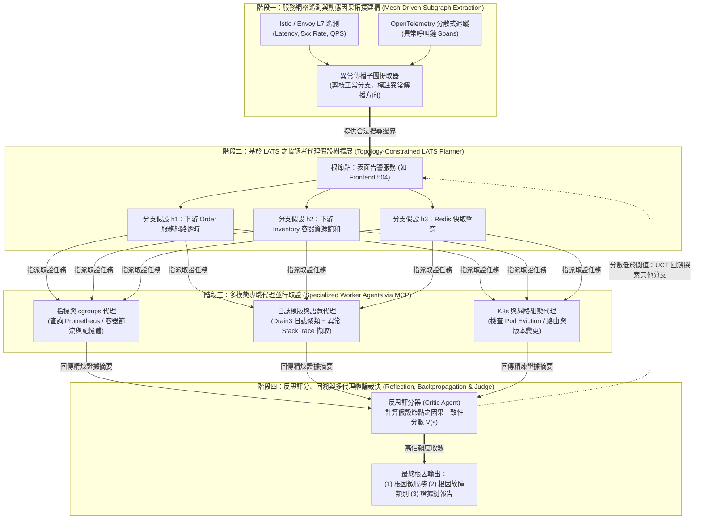

# 研究主題 01：結合服務網格動態拓撲與樹狀搜尋之多重代理微服務根因分析

- **中文暫定題目**：基於服務網格動態因果拓撲約束與語言代理樹狀搜尋之微服務多模態根因分析
- **英文暫定題目**：*Topology-Grounded Multi-Agent Root Cause Analysis for Microservices via Service Mesh Telemetry and Language Agent Tree Search*
- **核心關鍵字**：Microservices, Root Cause Analysis (RCA), Multi-Agent Systems (MAS), Service Mesh (Istio), Language Agent Tree Search (LATS), Multimodal Observability

---

## 一、 研究背景與痛點（Problem Statement & Research Gap）

在包含數十至數百個微服務的雲原生系統中，單一底層容器故障（如資源爭搶或資料庫連線池耗盡）會透過東西向呼叫鏈迅速傳播，引發跨服務的「警報海嘯（Alert Storm）」。現有根因分析（RCA）方法面臨三大研究缺口（Research Gaps）：

1. **傳統圖神經網路/統計因果方法（如 MicroRCA、CausalRCA）缺乏語意理解能力**：
   雖然能利用追蹤拓撲進行隨機漫步（Random Walk），但僅能處理數值型時間序列（Metrics），無法理解非結構化的容器錯誤日誌（Logs）、堆疊追蹤（Stack Traces）與 Kubernetes 控制平面事件（如 `OOMKilled`、ConfigMap 變更）。
2. **單一或線性多重代理（Linear Multi-Agent）易產生「拓撲幻覺」與「過早收斂」**：
   現有基於 LLM 的代理系統常在沒有嚴格服務呼叫邊界約束下盲目查詢日誌，導致將僅是傳遞錯誤的上游高流量節點（如 API Gateway，即 Hub Node）誤判為根因；且線性 ReAct 推理一旦早期假設偏離，便無法回溯（Backtrack）。
3. **跨模態對齊與時間延遲（Propagation Delay）被忽略**：
   故障從容器資源層傳播到服務網格 L7 HTTP 錯誤率存在數秒至數十秒的時間差，現有代理缺乏沿著服務網格即時拓撲進行逆向因果驗證的機制。

---

## 二、 核心研究問題（Research Questions）

- **RQ1（拓撲約束有效性）**：如何利用服務網格（Istio / Envoy）自動生成的即時 L4/L7 服務依賴圖與黃金指標，限制並引導多重代理的搜尋空間，消除跨無關微服務的幻覺檢索？
- **RQ2（非線性推理與回溯）**：如何設計結合蒙地卡羅樹搜尋（MCTS / LATS）與多代理角色分工的推理框架，使系統能同時探索多條故障假設分支，並在證據不足時自動回溯？
- **RQ3（跨模態衝突消解）**：當指標代理（Metrics Agent）、日誌代理（Log Agent）與追蹤代理（Trace Agent）得出矛盾的根因候選時，如何透過基於因果證據鏈的辯論機制（Debate-and-Verify）精確收斂至真實根因？

---

## 三、 方法論與系統架構設計（Proposed Methodology）

本研究提出一套名為 **MeshLATS-RCA**（暫稱）的四階段多重代理框架：

### 關鍵技術設計細節：
1. **服務網格拓撲剪枝（Service Mesh Subgraph Pruning）**：
   不讓 LLM 漫無目的地掃描全叢集 50 個微服務，而是先讀取 Envoy/Istio 匯出的邊級別指標（Edge Metrics），過濾掉延遲與錯誤率正常的子樹，僅將「異常傳播活性子圖（Active Anomaly Subgraph）」輸入給協調者代理，將搜尋空間縮減 70% 以上。
2. **拓撲導向之 UCT 樹狀搜尋（Topology-Guided UCT Selection）**：
   在 LATS 的節點選擇公式中加入拓撲異常先驗權重 $P_{\text{mesh}}(s, a)$：
   $$\text{UCT}(s, a) = Q(s, a) + c \cdot P_{\text{mesh}}(s, a) \frac{\sqrt{\ln N(s)}}{1 + N(s, a)}$$
   其中 $Q(s, a)$ 為 Critic Agent 對該診斷路徑證據強度的評分，$P_{\text{mesh}}(s, a)$ 為服務網格觀測到的下游異常相關係數。
3. **日誌模版壓縮與工具摘要（Log Drain + MCP Distillation）**：
   Log Agent 先透過 `Drain3` 將數萬行原始容器日誌聚類為數十個模版（Log Templates），僅針對異常時間窗內「新出現或頻率突增」的錯誤模版提取上下文，避免塞爆 LLM Context Window。

---

## 四、 創新點與預期學術貢獻（Contributions）

1. **提出結合服務網格 L7 遙測與多代理樹狀搜尋的混合架構**：首次將無侵入式服務網格拓撲作為多代理推理的硬性結構約束（Structural Grounding），有效解決單純 LLM 代理的「拓撲幻覺」與「Hub 節點誤判」。
2. **設計具備回溯能力的多模態取證與評分機制**：將 Metrics、Logs、Traces 與 K8s Events 封裝為標準化 MCP 工具，透過反思函數量化每個假設分支的因果合理性。
3. **在大型微服務基準集上實現 SOTA 定位精準度**：同時輸出「根因服務（Service-level）」與「細粒度故障類型（Indicator/Pod-level）」以及可解釋的因果證據鏈。

---

## 五、 實驗設計、比較基準與評估指標

### 1. 資料集與測試床
- **離線標準資料集**：`RCAEval`（包含 TrainTicket、Online Boutique、Sock Shop 共 735 個涵蓋 CPU/Memory/Disk/Network/Code 故障的多模態案例）。
- **線上即時測試床（加分項）**：在本地或雲端 K8s 部署 `Online Boutique` + `Istio`，使用 `Chaos Mesh` 注入複合故障。

### 2. 對比基準方法（Baselines）
- **傳統指標/追蹤因果方法**：`MicroRCA`、`CIRCA`、`RUN`、`CausalRCA`。
- **深度學習多模態方法**：`Eadro`、`Nezha`、`DiagFusion`。
- **單一代理與線性多代理方法**：`Single-LLM (ReAct)`、`AutoGen GroupChat RCA`、`MetaGPT/Standard Supervisor RCA`。

### 3. 核心評估指標（Metrics）
- **根因定位準確率**：$\text{AC@1}$、$\text{AC@3}$、$\text{AC@5}$ 以及 $\text{Avg@5}$。
- **細粒度故障分類準確率**：Macro-F1 Score（區分是 CPU 飽和、記憶體洩漏、網路延遲還是程式碼例外）。
- **消融實驗（Ablation Study）**：
  - 移除服務網格拓撲約束（w/o Mesh Topology Pruning）對準確率與 Token 消耗的影響。
  - 將 LATS 樹狀搜尋退化為線性 ReAct（w/o Tree Search Backtracking）的準確率下降幅度。
  - 單一模態缺失（w/o Logs、w/o Metrics、w/o Traces）的敏感度分析。
