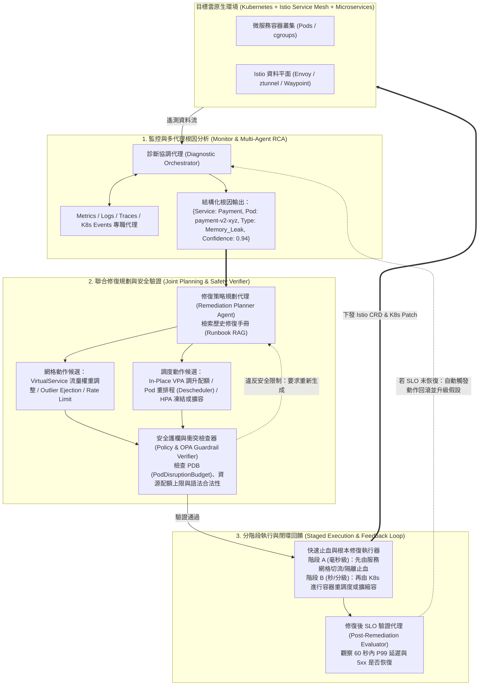

# 研究主題 02：根因驅動之雲原生自主自癒閉環——協同服務網格切流與 K8s 動態資源重調度

- **中文暫定題目**：根因驅動之雲原生微服務自主自癒架構：基於多重代理協同服務網格流量控制與容器資源重調度
- **英文暫定題目**：*Root-Cause-Driven Autonomous Self-Healing for Microservices: Coordinating Service Mesh Traffic Control and Kubernetes Resource Rescheduling via Multi-Agent Systems*
- **核心關鍵字**：Self-Healing Systems, Root Cause Analysis, Multi-Agent Systems, Service Mesh (Istio), Kubernetes Resource Scheduling, Closed-Loop AIOps, MTTR Reduction

---

## 一、 研究背景與痛點（Problem Statement & Research Gap）

這個主題是**將您指定的六大關鍵字（微服務、容器、服務網格、資源調度、多重代理、根因分析）100% 串聯成一個完整閉環**的旗艦級研究題目。

目前雲原生系統的研究中，「根因分析（RCA）」與「資源調度/流量控制（Scheduling & Traffic Management）」往往是**割裂的兩個領域**：
1. **現有自動擴縮容（如 HPA / VPA）是「症狀驅動（Symptom-Driven）」而非「根因驅動（Root-Cause-Driven）」**：
   當某個微服務因為**新版程式碼死鎖（Deadlock）**、**下游資料庫阻塞**或**慢速記憶體洩漏**導致延遲飆高時，傳統 HPA 只看到回應變慢或堆積增加，便盲目擴增 Pod 副本數（Scale-out），不僅浪費大量容器資源，甚至加速把下游資料庫打垮。
2. **現有 RCA 研究只停留在「診斷出問題（Diagnosis）」，缺乏「安全修復執行（Automated Remediation）」**：
   多數 RCA 論文在算出 `AC@1` 準確率後就結束了，仍需依賴人類工程師手動介入修改 Istio YAML 或 K8s Deployment，導致平均修復時間（MTTR）依然高達數十分鐘。
3. **單一維度的修復動作無法應對複雜故障**：
   有些故障需要**服務網格層面**動作（如金絲雀切流回滾、異常實例熔斷隔離、限流），有些則需要**容器資源調度層面**動作（如原地提升 cgroups Memory Limit、將 Pod 從異常節點遷移重排程）。若缺乏智慧協調，兩層控制器可能發生策略衝突（Oscillation / Conflict）。

---

## 二、 核心研究問題（Research Questions）

- **RQ1（根因到修復策略映射）**：如何根據多重代理診斷出的精細根因類別（應用程式瑕疵、容器資源瓶頸、節點硬體退化、外部網路抖動），自動合成最佳的「服務網格 + K8s 資源調度」聯合修復策略（Joint Remediation Plan）？
- **RQ2（安全驗證與防護欄設計）**：如何設計具備「修復前沙箱驗證（Pre-execution Dry-run / Policy Guardrails）」與「修復後 SLO 監控回滾」的多代理執行架構，防止 AI 代理產生破壞性指令？
- **RQ3（MTTR 與資源效率提升）**：相較於傳統 Kubernetes HPA + Istio 靜態熔斷設定，根因驅動的多代理自癒閉環能降低多少 SLO 違約時間（SLO Violation Duration）與不必要的容器擴容成本？

---

## 三、 方法論與系統架構設計（Proposed Methodology）

本系統設計遵循經典自主運算（Autonomic Computing）的 **MAPE-K（Monitor-Analyze-Plan-Execute over a Shared Knowledge Base）** 閉環，並將其升級為 **Agentic MAPE-K 架構**：

### 核心創新設計：「兩階段協同自癒（Two-Stage Coordinated Healing）」
傳統容器重排程或擴容需要 15~60 秒（映像檔拉取、容器初始化、JVM 預熱），這段期間大量使用者請求仍在失敗。本研究提出**「網格先行止血，調度隨後治本」**的雙層協同機制：
1. **第一階段（Fast Mitigation via Service Mesh，< 1 秒）**：
   一旦 RCA 定位到特定異常容器實例（如 `payment-pod-2` 因所在節點 I/O 異常導致延遲）或異常版本（`v2`），**服務網格執行代理**立即透過 Istio `VirtualService` / `DestinationRule` 將該實例或版本的流量權重降至 0% 或限制併發，在 1 秒內止住前端 5xx 錯誤。
2. **第二階段（Deep Healing via K8s Resource Scheduling，10~60 秒）**：
   在流量已被安全導開的保護下，**資源調度執行代理**根據根因執行治本操作（例如：若為容器 `Memory Limit` 過低則呼叫 K8s In-Place Pod Vertical Scaling 原地擴充記憶體；若為節點異常則將該節點標記 `Cordon` 並將 Pod 重新排程至健康節點），待健康檢查（Readiness Probe）通過後，再由服務網格平滑恢復流量權重。

---

## 四、 創新點與預期學術貢獻（Contributions）

1. **打破「只診斷不修復」的侷限**：建構從多模態根因分析（RCA）到服務網格（L7 流量控制）與 Kubernetes（容器資源調度）的端到端自主自癒閉環。
2. **提出「根因感知（Root-Cause-Aware）」對比「症狀感知（Symptom-Aware）」資源管理範式**：證明精確區分「程式碼 Bug」、「容器配額不足」與「下游阻塞」後再採取對應調度動作，能避免傳統 HPA 的盲目擴容與資源浪費。
3. **設計「網格毫秒級止血 + 調度秒級治本」的雙層時間尺度協同控制機制**，並整合基於 OPA（Open Policy Agent）與 `PodDisruptionBudget` 的確定性安全護欄，確保 AI 代理不會誤刪生產環境所有可用副本。

---

## 五、 實驗設計、比較基準與評估指標

### 1. 實驗場景設計（在 K8s + Istio + Online Boutique / TrainTicket 上測試 4 大類典型故障）
- **場景 A（應用層缺陷）**：金絲雀發布的新版容器存在資料庫連線洩漏（期望行為：Istio 切流回滾至舊版，而非 HPA 無限擴容新版）。
- **場景 B（容器資源配額不當）**：單一微服務遭遇真實流量暴增導致 CPU Throttling 與 OOM（期望行為：Istio 短暫限流保護 + K8s VPA/HPA 動態擴充資源）。
- **場景 C（局部灰故障 Gray Failure）**：某個副本所在節點遭受背景噪音干擾（Noisy Neighbor）（期望行為：Istio 驅逐該單一異常端點 + K8s 跨節點重排程）。
- **場景 D（下游外部依賴癱瘓）**：第三方支付网关延遲飆高（期望行為：Istio 啟動熔斷降級，K8s 維持現有副本數不盲目擴容）。

### 2. 對比基準（Baselines）
1. **K8s Default (HPA + Default Liveness Probe)**：僅依賴標準 CPU/Memory HPA 與容器重啟。
2. **K8s HPA + Static Istio Outlier Detection**：傳統靜態配置的雲原生韌性架構。
3. **Rule-based / Alert-driven Automation**：基於固定 Prometheus 告警規則觸發 Ansible/K8s 腳本（無深層 RCA）。
4. **Ours (Multi-Agent RCA + Mesh-Scheduling Coordinated Self-Healing)**。

### 3. 核心評估指標（Metrics）
- **MTTR（Mean Time to Recovery，平均恢復時間）**：從故障注入到系統 QPS 與 P99 延遲恢復至正常基準線（SLO）所需的秒數。
- **SLO 違約率（SLO Violation Ratio）**：故障期間超過 P99 延遲閾值或返回 5xx 的請求百分比。
- **修復期間額外消耗的容器資源成本（Resource Overhead in CPU/Memory Core-Hours）**：量化避免「錯誤盲目擴容」所節省的計算資源。
- **修復動作正確率與安全率（Remediation Success & Safety Rate）**。
