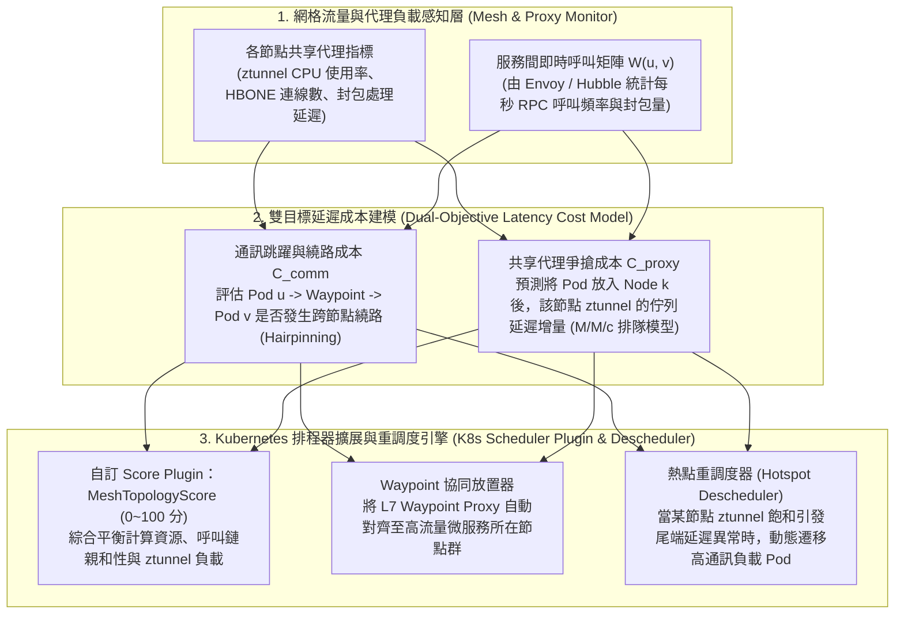

# 研究主題 03：無 Sidecar 服務網格（Ambient Mesh 與 eBPF）架構下之微服務尾端延遲感知資源調度

- **中文暫定題目**：無 Sidecar 服務網格架構下考量共享代理爭用與呼叫鏈親和性之微服務資源調度機制
- **英文暫定題目**：*Tail-Latency-Aware Resource Scheduling for Microservices in Sidecarless Service Meshes: Coordinating Shared Proxy Contention and Call-Graph Affinity*
- **核心關鍵字**：Service Mesh, Sidecarless Architecture, Istio Ambient Mesh (`ztunnel` / Waypoint), Cilium eBPF, Kubernetes Resource Scheduling, Tail Latency (P99), Microservice Placement

---

## 一、 研究背景與痛點（Problem Statement & Research Gap）

這是一個**純度極高、極受雲端系統與網路頂會（如 EuroSys、SOCC、INFOCOM、NSDI、IEEE TPDS/TNSM）青睞的系統排程（Systems & Scheduling）研究題目**。

近年來，服務網格正經歷從「每 Pod 一個 Sidecar（Per-Pod Envoy）」向**「無 Sidecar 架構（Sidecarless Service Mesh，如 Istio Ambient Mesh 與 Cilium eBPF）」**的重大典範轉移。然而，Kubernetes 現有的資源調度器（`kube-scheduler`）對此架構變革完全「無感（Mesh-Agnostic）」，引發了三個全新的研究問題：

1. **從「私有代理」變成「節點共享代理（Shared Node Proxy）」引發的新型資源爭搶（Noisy Neighbor in Data Plane）**：
   在傳統 Sidecar 模式中，每個 Pod 的 Envoy 資源算在該 Pod 自己的 `cgroups` 內。但在 **Istio Ambient Mesh** 中，同一台節點上的所有微服務容器共享同一個節點級別的 L4 代理 **`ztunnel`（DaemonSet）**，以及共享 Namespace 級別的 L7 **`Waypoint Proxy`**。如果排程器將多個高吞吐量、高頻加密通訊的微服務排程到同一台節點上，該節點的共享 `ztunnel` 會成為嚴重的 CPU 與網路瓶頸，拖累同節點所有其他微服務的 P99 尾端延遲（Tail Latency）。
2. **跨節點加密隧道（HBONE）vs. 同節點 eBPF 短路（Socket Redirection）的巨大延遲差異**：
   當兩個高頻呼叫的微服務被排程在**不同節點**時，流量必須經過 `Pod A -> ztunnel A -> (跨節點 mTLS HBONE 隧道) -> ztunnel B -> Pod B`；若排程在**同一節點**且搭配 eBPF，則能直接在核心空間進行 Socket 重導向。標準 K8s 排程器只看 CPU/Memory 剩餘量，完全不考慮服務網格的呼叫鏈拓撲與代理跳躍成本（Proxy Hop Overhead）。
3. **L7 Waypoint Proxy 的放置位置與彈性擴縮容失調**：
   在 Ambient Mesh 中，若微服務 A 在節點 1，微服務 B 在節點 1，但負責 L7 路由的 Waypoint Proxy 卻被排程器放到節點 3，原本同節點的通訊反而被迫跨節點來回繞路（Traffic Hairpinning / Tromboning）。

---

## 二、 核心研究問題（Research Questions）

- **RQ1（效能剖析與建模）**：在微服務基準工作負載下，傳統 Sidecar、Istio Ambient Mesh（`ztunnel` + `Waypoint`）與 Cilium eBPF 在不同 Pod 放置拓撲（同節點 vs. 跨節點）與不同併發負載下的 CPU/Memory 開銷與 P99 延遲數學模型為何？
- **RQ2（防止繞路與共享代理爭搶之排程演算法）**：如何設計一個感知服務網格資料平面拓撲的 Kubernetes 排程器外掛（Scheduler Plugin），在「利用同節點通訊親和性（降低網路延遲）」與「避免節點共享 `ztunnel` 過載（防止代理爭搶）」之間取得最佳平衡？
- **RQ3（Waypoint 協同放置與動態調度）**：如何根據微服務呼叫頻率矩陣，動態決定 L7 Waypoint Proxy 的副本數與節點放置位置，消除流量繞路（Traffic Hairpinning）？

---

## 三、 方法論與系統架構設計（Proposed Methodology）

本研究提出一套名為 **AmbientSched**（暫稱）的服務網格感知資源調度系統，作為 Kubernetes Scheduling Framework 的擴展外掛：

### 核心數學模型設計（論文亮點）：
對於待排程的微服務容器 $u$ 與候選節點 $n \in \mathcal{N}$，定義其服務網格綜合排程分數 $S_{\text{mesh}}(u, n)$：
$$S_{\text{mesh}}(u, n) = \alpha \cdot \underbrace{\sum_{v \in \text{Neighbors}(u)} W(u, v) \cdot \mathbb{I}(\text{Node}(v) = n)}_{\text{同節點高頻通訊獎勵 (Locality Gain)}} - \beta \cdot \underbrace{D_{\text{hairpin}}(u, \text{Waypoint}(u), n)}_{\text{L7 Waypoint 跨節點繞路懲罰}} - \gamma \cdot \underbrace{\Phi_{\text{ztunnel}}\left(L_{\text{net}}(n) + \lambda_u\right)}_{\text{節點共享代理飽和度非線性懲罰}}$$
- 當節點 $n$ 上的 `ztunnel` 負載 $L_{\text{net}}(n)$ 低於安全水位時，排程器傾向將高頻互動的微服務聚合在同一節點（最大化 eBPF / 本地迴路優勢）；
- 一旦該節點的 `ztunnel` 接近非線性排隊延遲轉折點，懲罰項 $\Phi_{\text{ztunnel}}$ 急遽上升，自動將後續高流量 Pod 分散至其他節點。

---

## 四、 創新點與預期學術貢獻（Contributions）

1. **首篇深入剖析無 Sidecar 服務網格（Ambient Mesh / eBPF）對容器排程影響的實證與建模研究**：揭示了 Sidecarless 架構雖節省了記憶體，卻引入了「節點級共享代理爭搶」與「L7 Waypoint 跨節點繞路（Hairpinning）」兩大新效能陷阱。
2. **提出網格拓撲與代理負載雙重感知的 Kubernetes 排程演算法**：透過實作標準 K8s `Score` 與 `Reserve` 外掛，無需修改微服務程式碼即可顯著降低呼叫鏈 P99 尾端延遲。
3. **實作 Waypoint Proxy 與業務 Pod 的聯合放置（Co-placement）機制**：解決 L4 與 L7 資料平面分離後的網路拓撲錯位問題。

---

## 五、 實驗設計、比較基準與評估指標

### 1. 實驗環境
- 多節點 Kubernetes 叢集（例如 4~8 個 Worker Nodes），分別配置：
  1. `Istio Classic (Sidecar mode)`
  2. `Istio Ambient Mesh (ztunnel + Waypoint)`
  3. `Cilium Service Mesh (eBPF mode)`
- 工作負載：`DeathStarBench`（Social Network / Hotel Reservation）與 `Online Boutique`，使用 `wrk2` 或 `Locust` 產生不同 QPS 強度的壓測流量。

### 2. 對比基準（Baselines）
- **K8s Default Scheduler (`LeastAllocated`)**：標準 K8s 分散排程。
- **K8s Binpacking (`MostAllocated`)**：緊密裝箱排程。
- **Static Pod Affinity**：僅使用靜態 K8s `podAffinity` 將相關服務綁在一起（未考慮 `ztunnel` 過載）。
- **Ours (`AmbientSched`)**：動態感知呼叫矩陣、Waypoint 位置與共享代理負載。

### 3. 核心評估指標（Metrics）
- **端到端尾端延遲（End-to-End Tail Latency）**：P50、P90、**P99 與 P99.9 回應時間（ms）**。
- **跨節點網路頻寬消耗（Cross-Node Network Traffic in MB/s）**：驗證減少跨節點繞路的效果。
- **資料平面代理資源開銷（Proxy CPU & Memory Utilization）**與各節點 `ztunnel` 負載均衡度（Jain's Fairness Index）。
