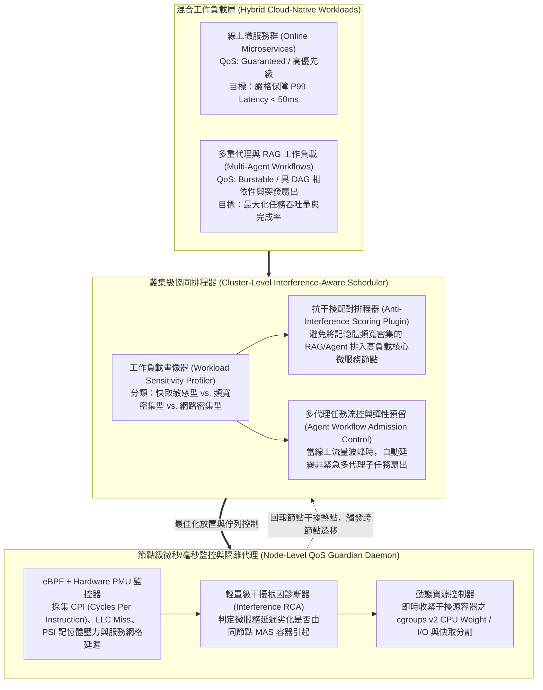

# 研究主題 05：線上微服務與多重代理 AI 推論混部叢集之 QoS 感知資源調度與抗干擾機制

- **中文暫定題目**：雲原生混部叢集中面向延遲敏感微服務與多重代理 AI 工作負載之 QoS 感知動態資源調度與干擾根因緩解
- **英文暫定題目**：*QoS-Aware Dynamic Resource Scheduling and Interference Mitigation for Co-located Microservices and Multi-Agent AI Workloads in Kubernetes Clusters*
- **核心關鍵字**：Workload Co-location (混部), Resource Scheduling, Kubernetes & Volcano, Microservices SLO, Multi-Agent LLM Workloads, Noisy Neighbor Mitigation, `cgroups v2`

---

## 一、 研究背景與痛點（Problem Statement & Research Gap）

在現代企業的雲原生 Kubernetes 叢集中，為了提高昂貴伺服器（包含 CPU 與 GPU 節點）的硬體利用率，越來越普遍將**「線上延遲敏感型微服務（Latency-Critical Microservices）」**與**「多重代理 AI 工作負載（Multi-Agent LLM Inference / RAG / Tool Execution）」**混合部署（Co-location）在同一個叢集甚至同一批節點上。

這種新型態的混合工作負載對傳統容器資源調度帶來了嚴峻挑戰：
1. **多重代理工作負載具有極端的「突發性與扇出效應（Bursty & Fan-out Traffic）」**：
   不同於傳統固定節奏的批次任務（如每日定時跑的 Spark Job），當一個多重代理系統被觸發（例如處理複雜客訴或執行自動化維運）時，Orchestrator Agent 會在瞬間同時喚醒 5~10 個子代理、並行查詢向量資料庫（Vector DB）、執行沙箱程式碼並產生大量網路與記憶體頻寬突刺（Memory Bandwidth & LLC Cache Contention）。
2. **Linux `cgroups` 無法隔離底層微架構資源爭搶（Micro-architectural Interference）**：
   即使 Kubernetes 為微服務容器與 AI 代理容器設定了明確的 CPU 與 Memory `requests/limits`，它們在同一實體節點上仍然共享 **Last-Level Cache (LLC，L3 快取)**、**記憶體頻寬（Memory Bandwidth）**、**磁碟 I/O** 與 **服務網格節點網路堆疊**。AI 代理與向量檢索的高密集記憶體存取會嚴重沖刷（Flush）同節點微服務的 CPU L3 快取，導致線上微服務的 P99 延遲在毫無 CPU 超標告警的情況下莫名飆升。
3. **缺乏針對「混部干擾根因」的細粒度動態隔離與雙排程器協同**：
   標準 `kube-scheduler` 負責微服務排程，而 `Volcano` 負責 AI/批次成組排程（Gang Scheduling），兩者缺乏基於即時 SLO 退化根因（RCA）的動態配額協調與驅逐機制。

---

## 二、 核心研究問題（Research Questions）

- **RQ1（混部干擾特徵剖析）**：當線上微服務與多代理 AI 工作負載（LLM 推論、RAG 向量檢索、工具沙箱容器）混部於同一 Kubernetes 節點時，底層資源（CPU 排程延遲、L3 快取未命中率、記憶體頻寬、網路 I/O）如何影響微服務的 P99 尾端延遲？
- **RQ2（干擾根因快速識別）**：當線上微服務發生 SLO 違約（延遲飆升）時，如何快速區分根因是「微服務自身流量突增」還是「同節點多代理任務造成的底層干擾（Noisy Neighbor）」？
- **RQ3（跨層動態排程與隔離）**：如何結合節點級別的動態 `cgroups v2` / Intel RDT（快取與記憶體頻寬隔離）與叢集級別的任務排程（優先級搶佔、Gang-aware 節流），在不犧牲微服務 P99 SLO 的前提下最大化叢集整體資源利用率？

---

## 三、 方法論與系統架構設計（Proposed Methodology）

本研究設計一套名為 **CoMesh-Sched**（或 **HarmonyKube**）的混部感知排程與干擾自癒系統：

### 三大核心技術機制：
1. **基於 CPI 與 PSI 的干擾根因定位（CPI & PSI-Based Interference RCA）**：
   利用 Linux Kernel `eBPF` 與硬體效能計數器（PMU）監測微服務容器的 **CPI（每指令週期數，Cycles Per Instruction）** 與 `cgroups v2` 的 **PSI（Pressure Stall Information）**。
   - 若微服務 QPS 未變，但 CPI 與 L3 Cache Miss 與同節點某個 AI Agent 容器的記憶體存取呈現高因果相關性，立即判定根因為**「底層混部干擾」**。
2. **干擾矩陣感知的排程評分演算法（Interference-Matrix-Aware Placement）**：
   將容器特徵向量化為 $\mathbf{v}_i = [\text{CPU}, \text{MemCap}, \text{MemBW}, \text{NetIO}]$，在排程器的 `Score` 階段計算待排程 AI 代理容器與節點上現有微服務容器的**干擾內積懲罰（Interference Penalty）**，實現「互補型工作負載（如計算密集與網路密集）」同節點混部，而「同質爭搶型」跨節點錯開。
3. **雙時間尺度防禦（Dual-Timescale Mitigation）**：
   - **微秒/毫秒級（本地節點）**：一旦偵測到微服務 P99 逼近 SLO 紅線，節點守護代理立即透過 `cgroups v2` 動態壓制（Throttle）同節點低優先級 Agent 容器的 CPU 配額與記憶體頻寬，毫秒級恢復微服務延遲。
   - **秒級（叢集排程層）**：若壓制持續超過閾值，觸發排程器將受壓制的 Agent 任務優雅遷移（Live Migration / Reschedule）至其他空閒節點。

---

## 四、 創新點與預期學術貢獻（Contributions）

1. **切入 AI 時代最迫切的雲原生混部難題**：探討「傳統微服務」與「新興多代理 AI 工作負載（LLM/RAG/Sandbox）」共存於同一 K8s 叢集時的資源交互影響。
2. **結合底層干擾根因分析（Micro-architectural RCA）與動態 `cgroups` 控制**：解決傳統 K8s 只看 CPU/Memory 配額而無法防範快取與頻寬爭搶的盲區。
3. **顯著提升叢集整體資源利用率（Cluster Utilization）**：在保證線上微服務 99% SLO 達標的前提下，將叢集平均 CPU/Memory 利用率從傳統專屬叢集的 25% 提升至 60% 以上。

---

## 五、 實驗設計、比較基準與評估指標

### 1. 實驗負載組合
- **線上微服務（高優先級 LC Workloads）**：`DeathStarBench` (Social Network) 或 `Online Boutique`，配置 Istio 服務網格。
- **多重代理與 AI 負載（彈性優先級 BE/Burstable Workloads）**：使用 LangGraph/AutoGen 運行的多代理任務流（包含本地 vLLM/Ollama 小模型推論容器、Milvus/Qdrant 向量檢索容器、Python 程式碼執行沙箱容器）。

### 2. 對比基準（Baselines）
- **Dedicated Clusters（無混部專屬隔離）**：微服務與 AI 代理完全分開在不同節點（延遲最穩，但機器成本高、利用率最低）。
- **Standard K8s Co-location (`kube-scheduler` + Static QoS)**：僅使用 K8s 原生 `Guaranteed` 與 `Burstable` 混部。
- **Volcano Default Batch Co-location**。
- **Ours (`CoMesh-Sched`：干擾感知排程 + `cgroups v2` 動態閉環壓制)**。

### 3. 核心評估指標（Metrics）
- **線上微服務 P99 延遲穩定度（P99 Latency & SLO Violation Rate）**。
- **叢集整體資源利用率提升幅度（Cluster CPU & Memory Utilization %）**。
- **多重代理任務平均完成時間（Agent Workflow Makespan / Throughput）**。
- **干擾發生後的自癒響應時間（Mitigation Latency in ms）**。
